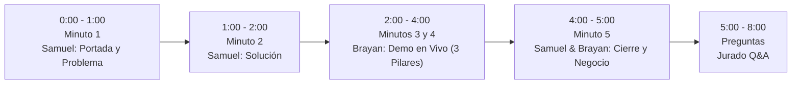

# 🎙️ GUION OFICIAL DEL PITCH FINAL (5 MINUTOS)
## Reto Agroindustria — Hackathon USCO 2026
**Equipo:** `syntax_error`  
**Expositores en tarima:** Samuel Chantre (Frontend) y Brayan Gasca (Lead Developer)  
**Tiempos:** 5 minutos exactos de exposición + 3 minutos de preguntas del jurado.  
**Diapositivas:** [http://localhost:3000/presentacion.html](http://localhost:3000/presentacion.html)  
**Sistema en Vivo:** [http://localhost:3000](http://localhost:3000) (IP Wi-Fi Local: `http://192.168.1.229:3000`)

---

## ⏱️ CRONOGRAMA MINUTO A MINUTO

---

### ⏱️ MINUTO 1 (0:00 - 1:00): ¿Qué hace el software? (Presentación Oficial)
👤 **Habla:** Samuel Chantre *(Lo que ya se sabe de memoria al 100%)*  
🖥️ **En pantalla:** Diapositiva 1 (Portada de syntax_error)

> *"Buenos días, jurados y evaluadores. Somos el equipo **syntax_error** (Samuel Chantre, David Laverde y Brayan Gasca).
> 
> Nuestro software se llama **Cacao Trazabilidad Huila**: es una plataforma web moderna, segura y 100% responsiva (Mobile-First), diseñada para operar tanto en computadores de oficina como en los celulares de los operarios en los centros de acopio.
> 
> **¿Qué hace exactamente el software?**
> Digitaliza y custodia todo el viaje del cacao huilense desde que el campesino entrega el grano fresco en baba hasta el comprador final. Registra la entrada de materia prima con identificadores únicos por lote, supervisa en tiempo real las pérdidas de peso en fermentación y secado, calcula el costo unitario de producción por kilogramo y genera un certificado digital con código QR para que cualquier persona en el mundo verifique su origen y calidad.
> 
> Y para entender el dolor real que esto resuelve en el Huila y ver el software funcionando en vivo, los dejo con mi compañero Brayan Gasca."*

---

### ⏱️ MINUTO 2 (1:00 - 2:00): El Dolor del Huila y Cómo lo Resolvemos
👤 **Habla:** Brayan Gasca  
🖥️ **En pantalla:** Diapositiva 2 (El Dolor de la Post-Cosecha)

> *"¿Por qué esto resuelve el dolor del Huila?
> El Huila, y especialmente municipios como **Rivera, Campoalegre y Algeciras**, produce cacao fino de aroma de talla mundial. Sin embargo, los centros de acopio campesinos siguen operando en cuadernos y libretas de papel. Esto genera tres problemas graves:
> 
> 1. **Pérdidas a ciegas:** El grano pierde peso en fermentación y secado sin control; nadie sabe si fue por calor, hongos o descuido.
> 2. **Ventas a pérdida:** Las asociaciones no saben cuánto les cuesta procesar un kilo de cacao seco y venden al ojo.
> 3. **Pérdida de ingresos:** Los campesinos **pierden hasta un 35% de sobreprecio** en mercados de exportación porque no tienen cómo demostrar que su cacao es 100% huilense y de calidad.
> 
> **¿Cómo lo resuelve nuestra plataforma?**
> 1. Elimina los papeles centralizando el inventario en la nube.
> 2. Dispara alertas automáticas si la merma supera el 15% técnico permitido.
> 3. Calcula el costo exacto por kilo (\$ COP/kg) para fijar precios rentables.
> 4. Permite aislar y bloquear lotes de mala calidad para que no contaminen la bodega.
> 5. Emite un certificado de trazabilidad con QR para recuperar ese 35% de sobreprecio.
> 
> Veámoslo ahora mismo en vivo en el sistema:"*

---

### ⏱️ MINUTOS 3 Y 4 (2:00 - 4:00): Demostración del Software en Vivo (2 Minutos)
👤 **Habla y maneja la pantalla:** Brayan Gasca  
🖥️ **En pantalla:** Navegador web en pantalla completa ([http://localhost:3000](http://localhost:3000))

#### 🌾 Pilar 1: Recepción, Calidad y Habeas Data (40 seg)
*(Abres [app/lotes](http://localhost:3000/lotes))*
> *"Aquí estamos en el módulo de recepción. Miren el panel superior: nos totaliza los kilos en bodega y los municipios activos. 
> 
> Miren esta innovación: implementamos el botón **Habeas Data** 👁️. Con un solo clic alternamos entre nombres protegidos (Productor A, B) y nombres reales (Don Carlos Dussán), blindando legalmente los datos de nuestros campesinos.
> 
> Además, si ingresa un lote con humedad indebida o plaga, aplicamos el **Bloqueo Preventivo de Calidad (RF09)**; miren cómo el lote CAC003 queda congelado con su motivo técnico, impidiendo que cualquier operario lo procese o lo mezcle por error."*

#### ⚙️ Pilar 2: Transformaciones, Merma Crítica y Costeo (40 seg)
*(Pasas a [app/transformaciones](http://localhost:3000/transformaciones))*
> *"Pasamos al módulo de procesos post-cosecha: Fermentación y Secado. El sistema valida el balance de inventario: si intentamos procesar más kilos de los que hay disponibles en bodega, el sistema bloquea la transacción protegiendo la consistencia contable.
> 
> Miren este caso real: ingresaron 100 kg y salieron 84 kg. Hubo una pérdida de 16 kg (16% de merma). Como la norma técnica tolera hasta el 15%, **el sistema dispara de inmediato la Alerta Roja de Merma Crítica (RF04)** y obliga al operario a justificar la incidencia antes de guardar. 
> 
> Al mismo tiempo, divide los gastos operativos y calcula en vivo el **Costo Unitario real (\$2.000 COP/kg)**, garantizando que la asociación nunca venda a pérdida."*

#### 📱 Pilar 3: Trazabilidad Pública y QR en Red Local (40 seg)
*(Pasas a [app/trazabilidad](http://localhost:3000/trazabilidad))*
> *"Finalmente, el eslabón de mayor valor: la **Ficha Pública de Trazabilidad**.
> Miren la pantalla: tenemos acceso rápido a todos los lotes y el sistema ya cargó el lote CAC004 de Don Carlos Dussán.
> 
> **Invito a los jurados a apuntar la cámara de sus celulares a la pantalla:** gracias a que configuramos la red local, al escanear el código QR se abre al instante en sus teléfonos el certificado digital oficial.
> 
> El comprador puede verificar el municipio de origen (Rivera), la fecha de recepción y cada etapa superada, mientras mantenemos bajo estricta **confidencialidad comercial** los costos y márgenes internos de la cooperativa (RF06)."*

---

### ⏱️ MINUTO 5 (4:00 - 5:00): Modelo de Negocio, Impacto y Cierre
🖥️ **En pantalla:** Vuelves a la presentación: Diapositiva 4 y Diapositiva 5.

👤 **Habla:** Samuel Chantre *(Diapositiva 4 - Viabilidad)*
> *"**¿Por qué este proyecto es viable y sostenible?**
> 1. **Impacto Social:** Beneficia directamente a más de **300 familias cacaoteras** de Rivera, Campoalegre y Algeciras, eliminando intermediarios y recuperando ese 35% de sobreprecio.
> 2. **Modelo de Negocio SaaS:** Cobramos una suscripción mensual a las asociaciones cacaoteras por el software de acopio, más una micro-tarifa por cada certificado QR emitido para sacos de exportación."*

👤 **Habla:** Brayan Gasca *(Diapositiva 5 - Confiabilidad Técnica y Cierre)*
> *"3. **Solidez Técnica:** Construido sobre Next.js, Supabase PostgreSQL, Clerk y **6 pruebas unitarias automáticas** que certifican las fórmulas contables y de mermas en menos de 40 milisegundos con cero margen de error.
> 
> **Próximos Pasos:**
> Integrar sensores IoT para medir temperatura y pH en tiempo real en los cajones de fermentación y formalizar el piloto en campo.
> 
> Con **Cacao Trazabilidad Huila** transformamos el sudor del campesino en valor certificado para el mundo.
> ¡Muchas gracias, señores jurados! Somos el equipo **syntax_error**."*

---

## 🛡️ BANCO DE RESPUESTAS RÁPIDAS PARA LAS PREGUNTAS DEL JURADO (MINUTOS 6 AL 8)

| Pregunta Típica del Jurado | Quién Responde | Respuesta Clave (Contundente y Técnica) |
|---|:---:|---|
| **¿Qué pasa si en la finca o centro de acopio no hay internet?** | **Samuel** | *"La aplicación está optimizada con arquitectura Mobile-First y PWA/cache local. El operario puede registrar datos en su celular y en cuanto detecta conectividad Wi-Fi o datos, sincroniza transaccionalmente con la base de datos."* |
| **¿Cómo garantizan que un operario no altere las mermas o costos?** | **Brayan** | *"A través de 3 capas: 1) Control de roles con Clerk (RBAC) donde el operario solo registra y no puede modificar reglas; 2) Validación matemática estricta con idempotencia para evitar duplicados; y 3) Tabla inmutable de auditoría (`auditoria_logs`) en PostgreSQL que registra quién, cuándo y qué cambió."* |
| **¿Por qué los costos son privados en el código QR?** | **Samuel** | *"Por confidencialidad comercial y protección de la asociación (RF06). El comprador internacional necesita verificar pureza, origen y buenas prácticas, pero revelar los márgenes operativos debilitaría la negociación de precio de los campesinos."* |
| **¿Por qué es difícil que los campesinos adopten esto?** | **Samuel** | *"Diseñamos la interfaz específicamente para ellos: botones táctiles grandes, modo oscuro/claro para alta visibilidad bajo el sol huilense, semáforos de color visuales y navegación inferior idéntica a WhatsApp."* |
| **¿Qué validaron en las pruebas automáticas?** | **Brayan** | *"Tenemos 6 pruebas nativas en TypeScript (`npm test`) que validan: cálculo de merma y disparo de alerta al 15.01%, rechazo de división por cero en costos, bloqueo de inventario negativo, y validación estricta de lotes bloqueados."* |
