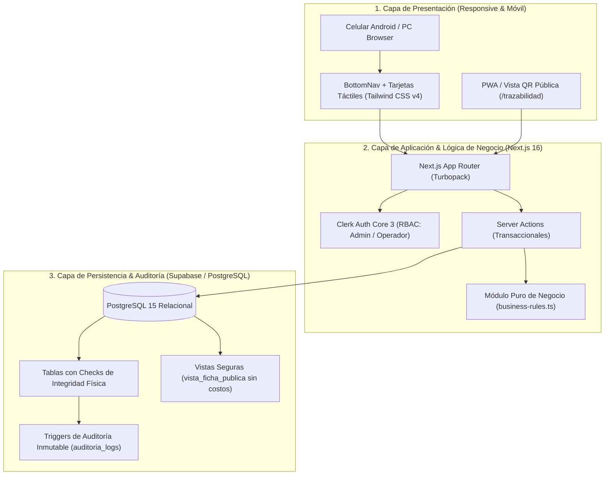
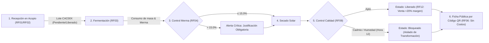
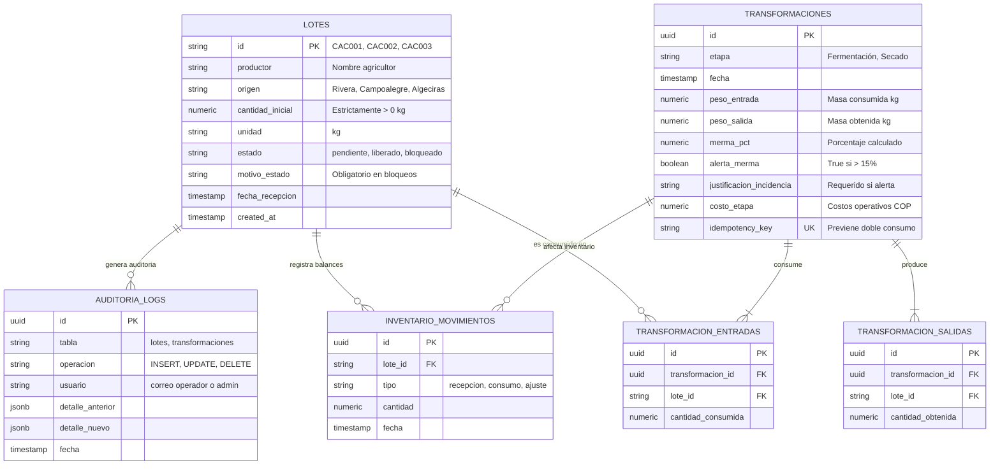

# Entregable E03 — Documento de Diseño de Arquitectura y Datos

**Proyecto:** Plataforma de Trazabilidad, Control de Mermas y Costos de Cacao — Huila  
**Equipo:** Equipo 3 (Cacao Trazabilidad Huila)  
**Fecha:** 16 de Octubre de 2026 — II Hackathon Agroindustria USCO  

---

## 1. Arquitectura General del Sistema

El sistema implementa una arquitectura moderna de **3 capas desacopladas**, priorizando la integridad de datos transaccionales y la seguridad en la nube:

---

## 2. Diagrama de Flujo de Trazabilidad y Calidad

El ciclo de vida del cacao desde la cosecha hasta la venta cumple con las reglas RF01 a RF12:

---

## 3. Modelo de Datos Relacional (ERD)

Diseñado en PostgreSQL con restricciones de integridad referencial, checks de masa positiva y balance dinámico:

---

## 4. Estrategia de Seguridad y Confidencialidad (RF06 y RF07)

1. **Aislamiento de Costos (RF06):** La vista `vista_ficha_publica` y el Server Action `getFichaPublicaAction` seleccionan explícitamente solo atributos agrícolas y de proceso, omitiendo cualquier campo financiero (`costo_compra_kg`, `costo_etapa`, `costo_acumulado`).
2. **Defensa en Profundidad (RBAC):** La autorización no depende únicamente del cliente; los Server Actions ejecutan validación estricta con `currentUser()` y verifican el claim `role === 'admin'` antes de invocar `cambiarEstadoLoteAction`.
