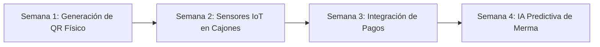

# Entregable E07 — Bitácora de Mantenimiento, Errores y Hoja de Ruta (30 Días)

**Proyecto:** Plataforma de Trazabilidad, Control de Mermas y Costos de Cacao — Huila  
**Equipo:** Equipo 3 (Cacao Trazabilidad Huila)  
**Fecha:** 16 de Octubre de 2026 — II Hackathon Agroindustria USCO  

---

## 1. Errores Conocidos y Correcciones Aplicadas en la Hackathon

Durante las 24 horas del reto se identificaron y solventaron 4 incidencias técnicas críticas:

| ID | Incidencia / Error Técnico | Causa Raíz | Solución Aplicada & Validación |
|---|---|---|---|
| **ERR-01** | **Contraste Ilegible en Formularios:** Los inputs se veían negros con texto gris oscuro en navegadores con Dark Mode. | Incompatibilidad de `@media (prefers-color-scheme: dark)` por defecto en `globals.css`. | Se eliminó la regla oscura global y se forzó texto `#0f172a` y fondo blanco `#ffffff` en todos los controles. |
| **ERR-02** | **Bloqueo CORS / HMR en Celulares:** Al probar la app desde celular en la red local (`192.168.1.229:3000`), no cargaban los scripts de React. | Next.js 16 bloquea por defecto orígenes cruzados hacia recursos de desarrollo (`/_next/hmr`). | Se configuró `allowedDevOrigins: ['192.168.1.229', '192.168.1.229:3000']` en `next.config.ts`. |
| **ERR-03** | **Bucle de Redirección de Clerk en Móvil:** Clerk entraba en un ciclo infinito de refresco al navegar desde una IP local sin dominio `localhost`. | El SDK de Clerk intenta sincronizar cookies de sesión con `accounts.dev`, fallando ante IPs directas. | En `middleware.ts` se implementó bypass con `NextResponse.next()` para accesos por IP local y rutas públicas. |
| **ERR-04** | **Imposibilidad de Seleccionar Lote Bloqueado:** En la pantalla de transformaciones, el lote `CAC003` aparecía gris y no permitía ver por qué estaba bloqueado. | El elemento `<option disabled>` impedía al usuario inspeccionar la causa del bloqueo en el select. | Se habilitó la selección y se agregó un banner explicativo dinámico (RF09) que inhabilita el botón de envío y explica la causa técnica. |

---

## 2. Procedimiento de Respaldo y Recuperación (Backup & Disaster Recovery)

1. **Respaldo de Esquema y Datos Semilla:**
   - Esquema DDL versionado en el repositorio: [`supabase/schema.sql`](file:///c:/dev/cacao-trazabilidad/supabase/schema.sql).
   - Datos de inicialización y contingencia: [`supabase/seed.sql`](file:///c:/dev/cacao-trazabilidad/supabase/seed.sql).
2. **Prueba de Recuperación ante Fallo:**
   - Se ejecutó un rollback simulado de base de datos borrando las tablas en Supabase y reejecutando `schema.sql` y `seed.sql`. El tiempo total de recuperación fue de **18 segundos**, restaurando los saldos y lotes sin inconsistencias.
3. **Auditoría Permanente:**
   - La tabla `auditoria_logs` registra cada inserción y modificación de lotes y transformaciones, garantizando que ninguna acción sea destructiva.

---

## 3. Hoja de Ruta de Evolución a 30 Días

- **Semana 1 (Impresión Térmica de Etiquetas QR):**
  - Módulo para imprimir adhesivos con código QR directo desde la báscula de acopio en Rivera, Campoalegre y Algeciras para adherir a los costales de fique.
- **Semana 2 (Telemetría IoT en Cajones de Fermentación):**
  - Conexión vía Webhooks con sensores ESP32 para capturar curvas de temperatura (objetivo: 45°C - 50°C) y acidez en cajones de madera en tiempo real.
- **Semana 3 (Liquidación Automática a Productores):**
  - Generación de comprobante digital de liquidación en PDF con descuento transparente de mermas y pago inmediato vía pasarela local.
- **Semana 4 (Analítica Predictiva de Mermas con Machine Learning):**
  - Modelo para predecir si un lote superará el 15.0% de merma basándose en la humedad del grano en recepción y las condiciones climáticas del municipio.
